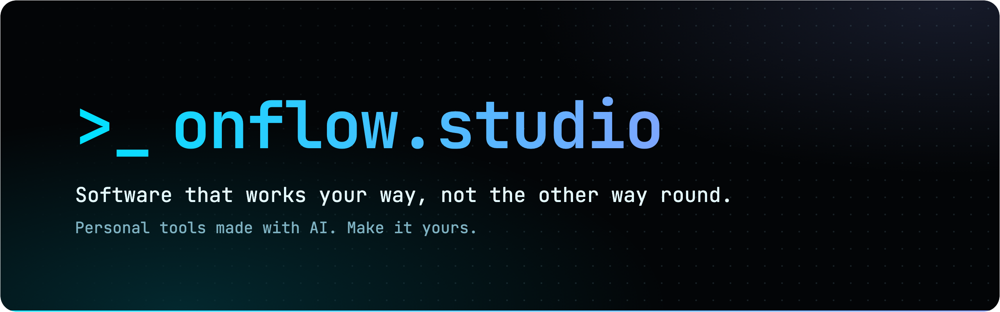
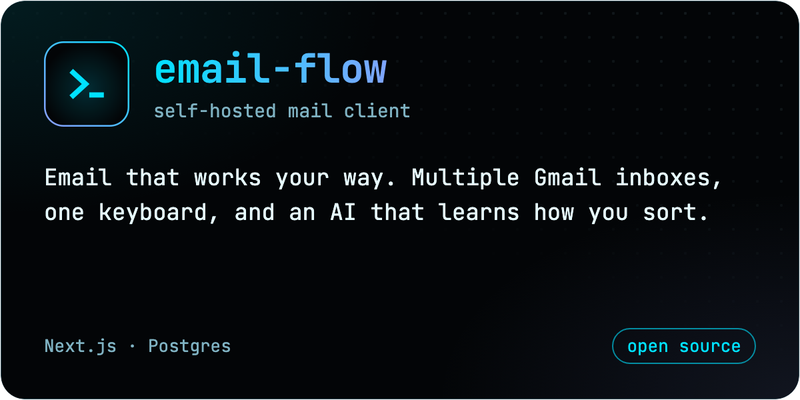
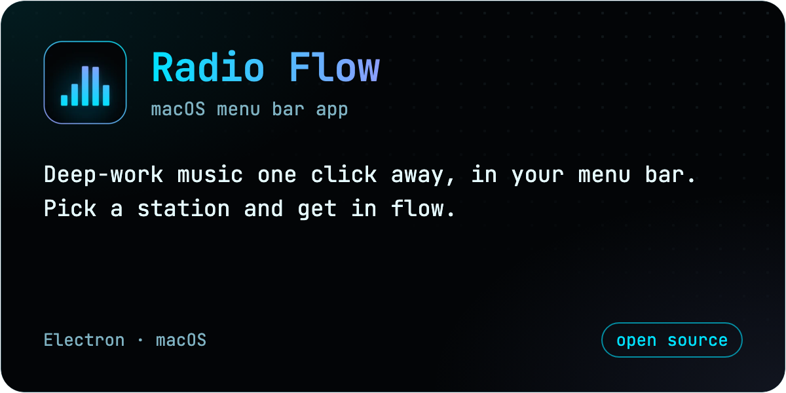
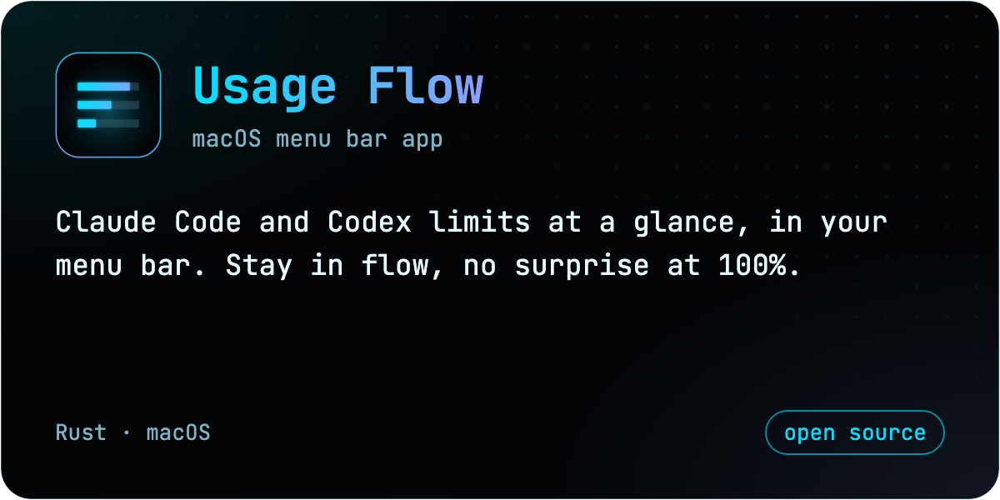
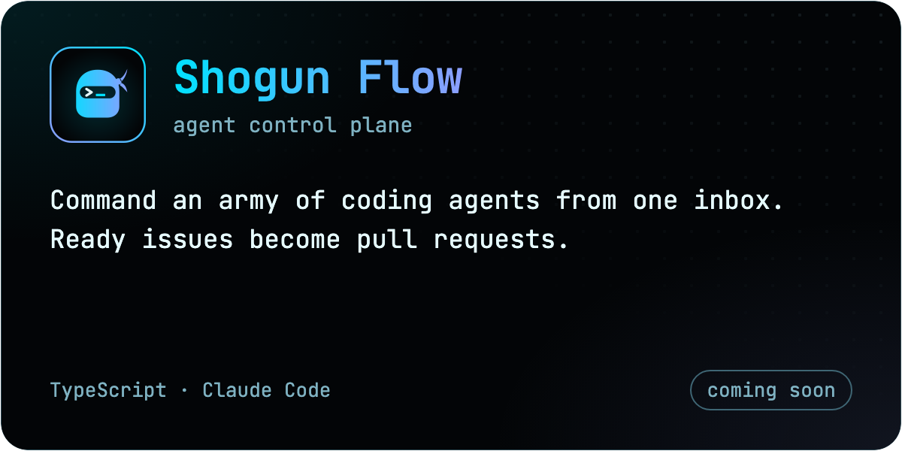

A small open source studio making personal software with AI. Each tool started as one person's way of working, then opened up so you can fork it and have your AI make it yours.

## Projects

  
  

  
  

Download <a href="https://github.com/onflow-studio/radio-flow/releases/latest">Radio Flow</a> or <a href="https://github.com/onflow-studio/usage-flow/releases/latest">Usage Flow</a> for macOS, or <a href="https://github.com/onflow-studio/email-flow/blob/master/docs/SELF-HOST.md">self-host email-flow</a>. More on <a href="https://onflow.studio">onflow.studio</a>.

## How we build

- **It works your way.** Software should bend to how you work, not train you to work for it.
- **Make it yours with AI.** Everything here is designed and built with AI, feature by feature. Fork it and keep the conversation going.
- **Keyboard first.** Every action has a key. A terminal that grew up.
- **Own your data.** Your data lives in your own database or on your own machine. No telemetry.

<a href="https://onflow.studio">onflow.studio</a> · MIT licensed · issues and ideas welcome in each repo
